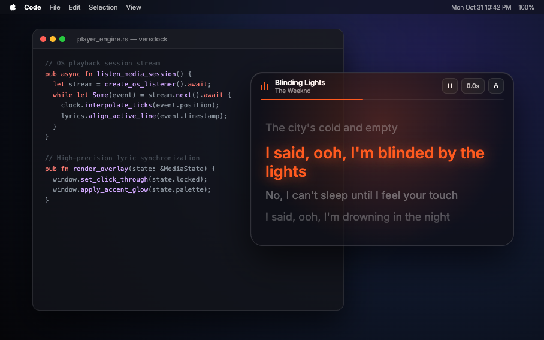
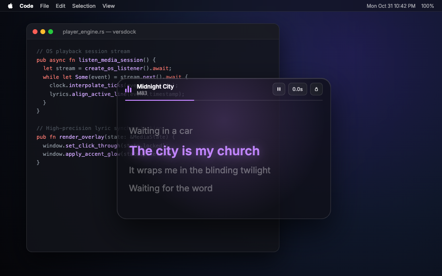
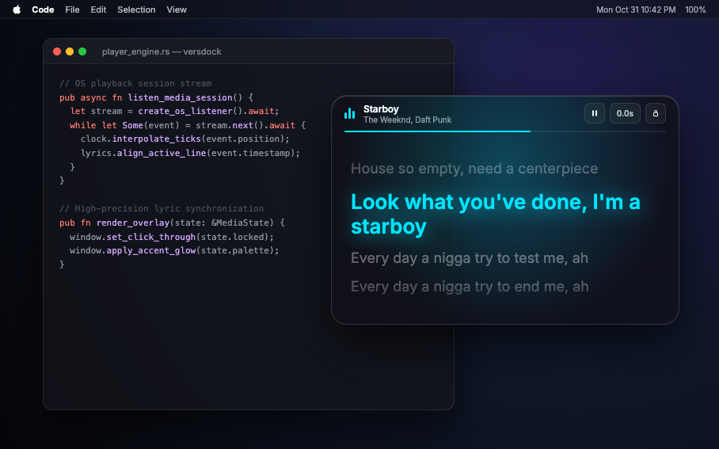
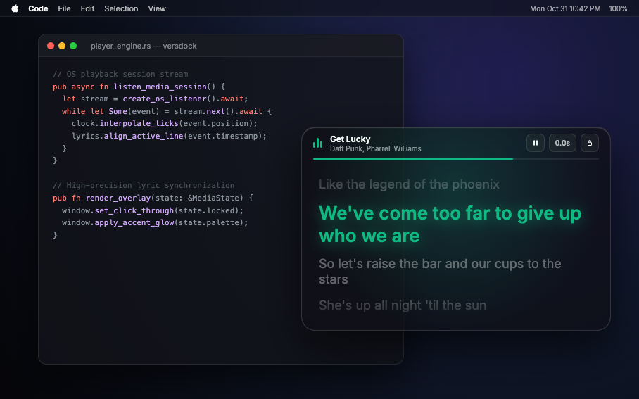
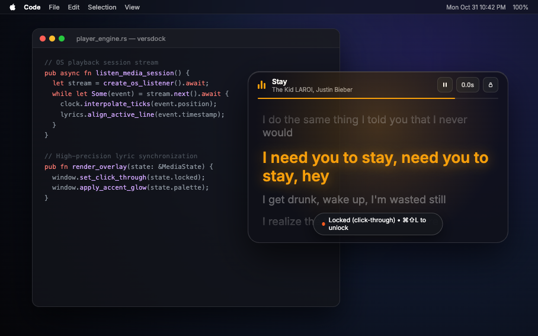

# Versdock

**Synced lyrics that float over your desktop — for any music app, with zero logins.**

Like Apple Music or Spotify lyrics, but floating directly over your workspace, editor, browser, or wallpaper. Versdock listens to what your OS media session is playing and renders an elegant, line-synced lyrics dock.



---

## Features

### 🎵 Live Synced Lyrics Over Desktop
Follows the song currently playing on your Mac or Windows PC. Automatically fetches timestamped LRC lyrics from [LRCLIB](https://lrclib.net) with millisecond-precision clock extrapolation and drift compensation.



### 🎨 Dynamic Album Art Colors & Backdrop Modes
Pulls palette colors directly from the currently playing album artwork (or choose from 6 hand-picked accent presets: Cyan, Sunset Amber, Electric Violet, Emerald, Rose Gold, Monochrome). Choose between **Glass blur**, **Clear minimal**, or **OLED Dark** backdrops.



### 📌 Pin, Drag & Seek
- **Drag & Position**: Place the dock anywhere on your multi-monitor desktop.
- **Click-to-Seek**: Click on any lyric line to jump straight to that moment in the track.
- **Micro Sync Nudge**: Adjust offset by ±250ms or ±500ms for tracks that lead or lag, automatically remembered per track.



### 👻 Ghost Passthrough Mode (`⌘⇧L` / `Ctrl+Shift+L`)
Lock the dock to pass clicks straight through to your code editor or windows underneath. Lyrics stay visible while never getting in your way.



---

## How It Works

```
[Apple Music / Spotify / YT Music / any app]  plays audio
        │  OS media session (no logins, no keys, ever)
        ▼
playback clock (Rust) ── snapshot → anchor → extrapolate → drift fix
        │
        ▼
LRCLIB (free, no API key) + LRC parser + per-track local cache
        │
        ▼
transparent overlay ── drag · pin · click-through lock · album themes
```

- **Zero accounts / zero logins**: Never touches your Spotify/Apple accounts. Listens to OS media sessions (macOS MediaRemote & AppleScript / Windows SMTC).
- **Free & community-powered**: Uses LRCLIB for line-synced lyrics.
- **Lightweight Tauri 2.0 app**: Rust backend with zero runtime bloat.

---

## Downloads & Releases

Pre-built standalone releases are available on the [Releases](https://github.com/Jotharsh/versdock/releases) page:

- **macOS (Apple Silicon & Intel)**: `.dmg` and `.app`
- **Windows (x64)**: `.exe` installer / `.msi`

---

## Keyboard Shortcuts & Controls

| Shortcut / Action | Action |
|---|---|
| `⌘⇧L` (Mac) / `Ctrl+Shift+L` (Win) | Toggle click-through lock (ghost overlay) |
| Click any lyric line | Seek to timestamp |
| `⚙` Button | Open settings sheet (Backdrops & Color Themes) |
| `◀ / ▶` Nudge | Adjust sync offset (saved per track) |
| Top bar drag | Reposition window |

---

## Development

```bash
git clone https://github.com/Jotharsh/versdock.git
cd versdock
npm install
npm run tauri dev
```

Build standalone installer:
```bash
npm run tauri build
```

---

## Status — Milestones

1. ✅ Overlay shell + playback clock + LRC parser + demo track
2. ✅ LRCLIB fetch + per-track disk cache + duration-tolerance matching
3. ✅ macOS media bridge: MediaRemote + AppleScript fallback
4. ✅ Painter: dynamic album-art accent palette + presets
5. ✅ Cross-platform CI (.github/workflows/build.yml for macOS & Windows)
6. ✅ Redesigned modern overlay UI with animated equalizer & click-to-seek

---

Part of [dailytech.build](https://jotharsh.github.io/dailytech-site/) — one free, open-source build every day. MIT licensed.
